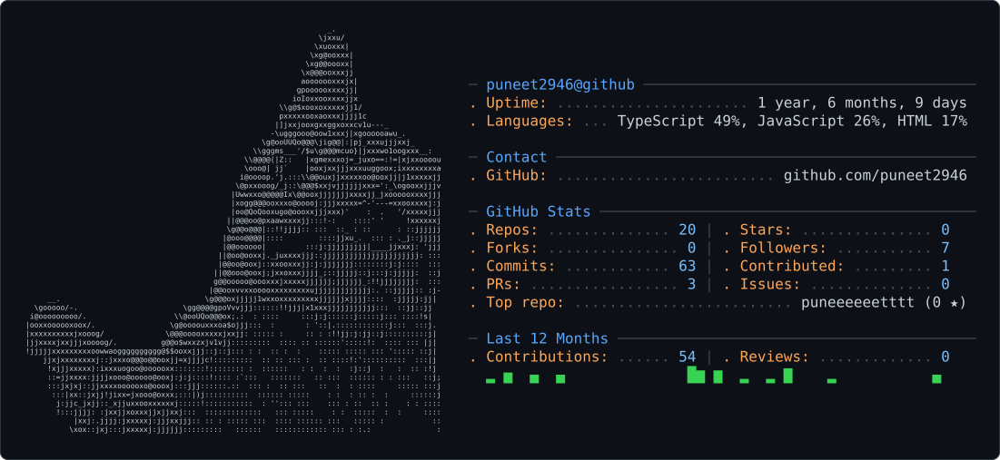

<picture>
  <source media="(prefers-color-scheme: dark)" srcset="dark_mode.svg" />
  <source media="(prefers-color-scheme: light)" srcset="light_mode.svg" />
  
</picture>

# P U N E E T

### `CS Student • Full-Stack Developer • AI Enthusiast`

Building things for the web. Exploring the possibilities of AI.

  
  
  

---

## `01` — About Me

I'm Puneet, a Computer Science student specializing in AI/ML at
**Newton School of Technology, Rishihood University**.

I'm interested in building useful products that combine thoughtful
user experiences, solid engineering, and intelligent systems.

- Currently exploring full-stack development and AI-powered applications.
- Working with React, TypeScript, JavaScript, and Python.
- Learning through hands-on projects, problem-solving, and experimentation.
- Interested in AI, software engineering, and open-source development.

> I don't just want to learn how technology works. I want to build things with it.

---

## `02` — Tech Stack

### Languages

  

### Frontend & Frameworks

  

### Backend & AI

  
  

### Tools & Workflow

  

---

## `03` — Selected Projects

### Pathfinder — AI Career Navigator

An AI-powered career guidance application that helps users navigate their
career paths through personalized roadmaps and actionable recommendations.

- Personalized career roadmaps
- Skill-gap analysis and recruiter expectations
- Project recommendations and internship planning
- AI-powered guidance using Google Gemini

**Stack:** React · TypeScript · Vite · Google Gemini API · Vercel

### CineSearch — Movie & TV Explorer

A web application for searching and exploring movies and television shows
through a clean, responsive interface.

- Search and explore entertainment content
- Responsive user interface
- Interactive frontend experience

**Stack:** HTML · CSS · JavaScript

---

## `04` — GitHub Statistics

 

---

## `05` — Currently Working On

- Strengthening full-stack development fundamentals.
- Improving problem-solving skills through DSA.
- Exploring practical AI integrations in web applications.
- Building projects that solve real problems.
- Becoming a better engineer, one commit at a time.

---

## `06` — Let's Connect

  

<i>Consistency &gt; Perfection.</i>

 

Learning continuously. Building intentionally.

